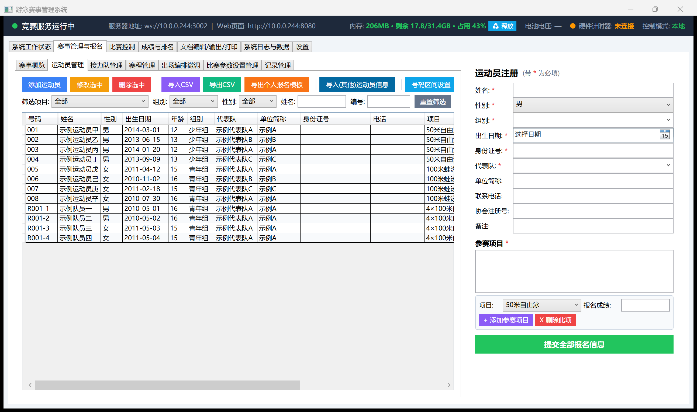
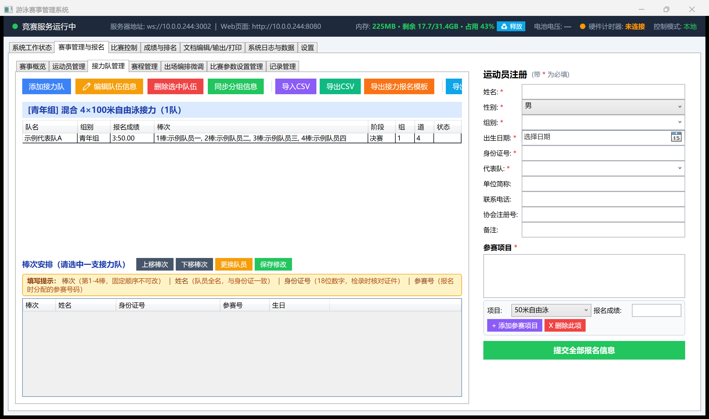
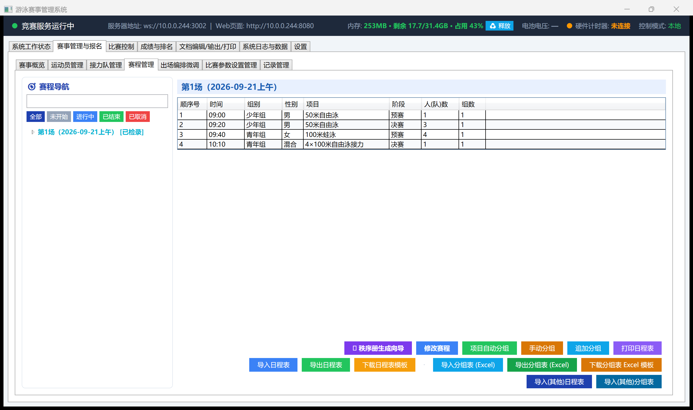
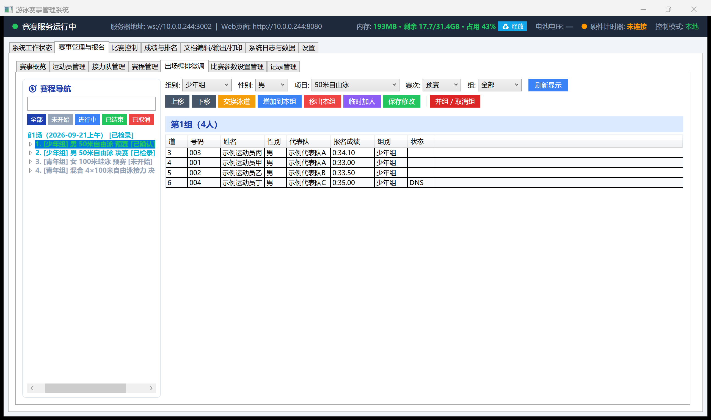
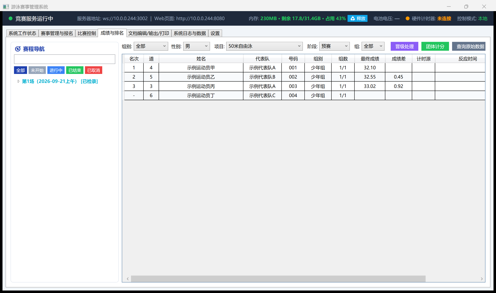
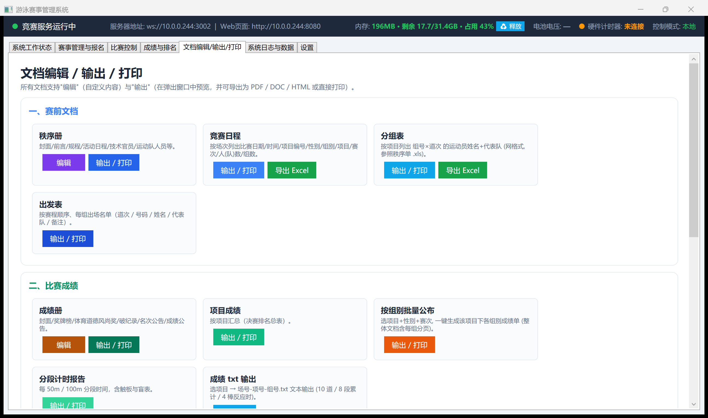
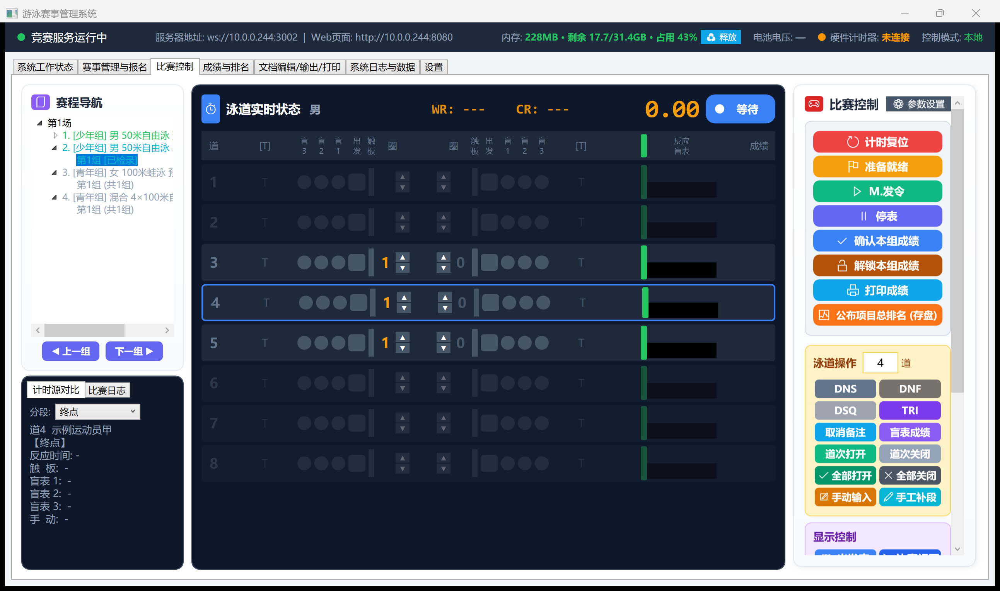

# Swimming Meet Management & Timing System User Manual

**Version v2026.10.14** · Applies to `SwimmingScoreboard_Setup_v20261014` and later installer packages

> This version focuses on three additions: **system-wide Chinese/English bilingual UI** (previously only mentioned once in the changelog, now a proper section), **one-click competition-rule template import** (International / Domestic / U-Series / Regional — auto-fills events, age groups, genders, and stages), and **a round of field-tested fixes to the Race Control web page** (race_control.html) covering heat-status display, blind-watch result feedback, lap-count alignment, hardware backup-log queries, and more (9+ issues). The new "Competition Parameter Settings," "Display Control," and "Units & Bib Number Allocation" sections carry over the prior version's text; no new screenshots were added this round.

---

## How to Use This Manual

- **Setting up for the first time, running your first meet** → Read **Chapters 1–3**, follow them step by step, and you'll be up and running.
- **Something's gone wrong on meet day** → Jump straight to **Chapter 12, On-Site Troubleshooting Cheat Sheet**, which solves most problems in one page.
- **Want to understand why a rule exists** → Read **Chapter 4, The Five Rules** — that's the root of the system's behavior.
- **Want to run an international meet in English** → Read **Section 2.6, Chinese/English Bilingual UI**.
- **Technical integration, hardware debugging** → Read **Appendix A, Hardware Protocol** and **Appendix B, File Reference**.

> Every paragraph marked **⚠** throughout this manual exists because someone learned it the hard way on-site. Follow it; don't work around it.

---

# Part One: Setup and Running a Meet

## 1. System Components

This system is **one program, many roles**: the same main application behaves as a different machine depending on how it's started.

### 1.1 Five Desktop Programs

| Program | Installed Where | Does What |
|------|---------|--------|
| **SwimmingScoreboard.exe** (Main Server) | Meet office | The single source of truth for competition data: rosters, schedule, heats, results, records, document output. Runs a WebSocket (3002) and a web server (8080) |
| **RemoteTimingControl.exe** (Race Control / Timing Station) | Poolside, wired to the hardware timer | Ready / start / timing / rulings / confirm results. **This is the machine actually connected to the hardware** |
| **ScheduleEditor.exe** (Schedule Editor) | Scheduling desk | Registration, seeding, promotions, result corrections, document printing. Doesn't connect to hardware, doesn't time |
| **RegistrationTool.exe** (Registration Tool) | Check-in desk | On-site late registration |
| **RemoteDisplayControl.exe** (Display Control) | Big-screen station | Big-screen preview and mode switching |

### 1.2 Six Web Pages

Open `http://<main-server-IP>:8080/xxx.html` in a browser:

| Page | Who It's For |
|------|-------|
| `display.html` | **Big screen**: live racing, heat results, event rankings, awards, welcome screen, schedule |
| `race_control.html` | Race control web console (works on tablets) |
| `query.html` | Results lookup (spectators/coaches) |
| `register.html` | Online registration |
| `checkin.html` | Check-in desk |
| `leaderboard.html` | Rankings board |

> There's also `control.html` (the display-control web page, see 10.4) and a developer/debug-only `test_bot.html` (automated test bot), which isn't shipped with the regular installer and isn't covered in detail in this manual.

### 1.3 Three Typical Setups

**A. Single Machine** (small meets)
One main server does everything: data + timing + big screen. The big-screen browser connects to its own localhost:8080.

**B. Main Server + Timing Station** (recommended, the default this manual assumes)
The main server handles data; the timing station poolside handles timing — each has its own job. The big screen and all other web pages connect to the main server.

**C. Main Server + Timing Station + Schedule Editor** (large meets)
Add a scheduling desk so later events can be scheduled while racing is underway.

⚠ **For setups B and C, start the main server with a role parameter** (see 2.3) — it automatically removes the "Race Control" tab, since timing is the timing station's job; removing the entry point prevents two places from starting the race at once.

### 1.4 Machine Requirements

- Windows 10 / 11, 64-bit
- .NET Framework 4.5 or later (built into Windows)
- **VC++ 2015-2022 Redistributable** (bundled with the installer, installed automatically)
- The timing station needs a serial or network port to connect the hardware timer
- All machines on the same LAN, with network reachability between them

---

## 2. Installation and Startup

### 2.1 Installation

1. Unzip `SwimmingScoreboard_Setup_vYYYYMMDD_N.zip`
2. Right-click `Setup.exe` → **Run as administrator**
3. Pick an install directory (default `C:\SwimmingScoreboard`) → you can choose **whether to create a desktop shortcut** (checked by default) → click through to finish

The installer does three things: lays down the program files, installs the VC++ redistributable (auto-skipped if already installed), and creates the desktop shortcut (unless you unchecked it in the previous step).

⚠ **Don't skip the VC++ redistributable.** Without it, `SQLite.Interop.dll` can't load and the competition database never opens — results don't get saved, there are no rankings, heat results can't be produced, and **nothing on screen looks wrong**. A whole day was once lost on-site to this exact problem. The program now pops up a warning at startup, but it's still best to let the installer install it.

### 2.2 Web Files Must Be Updated Together With the EXE

⚠ The web pages and the main program are **versioned and changed together**. Swapping only one half produces hard-to-diagnose symptoms like "device status lights won't refresh" or "the race log doesn't move."

The system guards against this itself:
- Web pages are served by the main program and **never cached by the browser** — a refresh always gets the latest version
- Pages and the main program each carry a version number; when they don't match, a **red banner** appears at the top of the page naming both versions, and the main server's "System Log" calls it out too

If you see the red banner, press **Ctrl+F5** to force-refresh; if it's still mismatched, that machine's `Web\` folder didn't get updated along with the EXE.

### 2.3 Startup Order

**① Main Server** (start first)

Double-click the desktop icon. For the "main server + timing station" setup, use the shortcut with the parameter instead:

```
SwimmingScoreboard.exe --role server
```

With `--role server`:
- The "Race Control" tab is removed (not disabled — it simply isn't there)
- It no longer handles timing; all timing commands are refused with an explanation

After startup, check the top bar: `Server Address: ws://192.168.x.x:3002 | Web Page: http://192.168.x.x:8080` — give this IP to the other machines.

**② Timing Station**

Double-click `RemoteTimingControl.exe` → log in → fill in the main server's IP under "Main Server" at the top → connect.
Then go to "Race Control → System Hardware" and connect the hardware timer.

**③ Schedule Editor / Registration Tool / Display Control**

Fill in the main server IP and connect the same way.

**④ Big Screen and Web Pages**

Open `http://<main-server-IP>:8080/display.html` in a browser, press F11 for fullscreen.

### 2.4 Login

All five desktop programs share the same dark-themed login window. **The default account on first run is `admin` / `123456`** (the program writes this default automatically if the credentials file doesn't exist yet — see Appendix B for the file location). After logging in, immediately change your password under "Parameter Settings → Username and Password."

### 2.5 Firewall

The first time you start the program, Windows will ask whether to allow network access — **you must choose "Allow"** (check both private and public networks). Otherwise other machines can't connect.

Ports that need to be allowed: **3002** (WebSocket), **8080** (web pages).

### 2.6 Chinese/English Bilingual UI

As of this version, **all five desktop programs and every web page support switching between Chinese and English**, suited to international meets with overseas athletes/officials.

**Where to switch**:

| Location | How |
|------|-------|
| Main Server / Timing Station / Schedule Editor / Registration Tool / Display Control (the five desktop programs) | The **中文 / English** button on the "Settings" page — one click switches the whole program's UI (including dialogs, menus, system log, and exported-file headers) |
| Web pages (`display.html` / `race_control.html` / `query.html` / `register.html` / `checkin.html` / `leaderboard.html` / `control.html`) | An independent language button in the top-right corner of each page, stored locally in the browser; not linked to the desktop clients |

**Automatic cross-client sync** (a system-level feature): switching language once on the main server's "Settings" page automatically switches **every connected desktop client** (ScheduleEditor.exe / RemoteTimingControl.exe / RegistrationTool.exe / RemoteDisplayControl.exe) too; as soon as these clients connect to the main server, their UI language is immediately calibrated to the main server's current language — no need to set each machine separately. Web pages aren't affected by this sync and choose independently.

**Two more things follow the language too**:
- The desktop shortcut and Start Menu entry names switch (Chinese name ↔ English name) along with the language
- When the timing station switches languages, it pushes the language setting down to the **hardware timer** (new protocol command `0x3B`, see Appendix A) — the text on the hardware console switches too

**Dialog buttons don't depend on the Windows system language**: every OK/Cancel/Yes/No dialog now uses the program's own custom-drawn style (`AppMessageBox`) instead of calling the native Windows message box — even on a Chinese Windows install, once the program is switched to English its dialogs correctly show `OK` / `Cancel` / `Yes` / `No`, so you'll never see "the program is in English but the dialog buttons are still in Chinese."

⚠ Event names, age-group names, and gender are each **both display text and the underlying value used for internal matching**. Chinese and English each have their own standard set of values (e.g., gender's `男/女/混合` corresponds to `Men/Women/Mixed`). Switching languages after athletes are already registered won't force-translate their already-recorded gender/age-group data — so it's best to **settle on a language before you start registering**. Switching mid-registration won't lose data, but old- and new-language candidate values may both appear in dropdowns, making it easy to pick the wrong one.

---

## 3. Running a Full Meet, Start to Finish

Walk this line start to finish and you've run a complete meet. The machine for each step is noted in parentheses.

### 3.1 Before the Meet (Main Server / Schedule Editor)

**① Create a New Meet**
"Events & Registration → Overview → New Meet," fill in the name, date, location, and officials roster. **Pool length/lane count** have moved to the next step, "Competition Parameter Settings" — the "Competition Mode" on the Overview page is now read-only and simply follows the competition rule, rather than being chosen here separately.

**② Competition Rule → One-Click Import of Age Groups / Events / Gender / Stages**

"Competition Parameter Settings" has a **"Competition Rule"** dropdown at the top with four options:

| Option | Use Case |
|------|---------|
| **International (FINA / World Aquatics)** | International meets, events/age-groups use standard World Aquatics English terminology |
| **Domestic** | Regular domestic meets (previously named "Domestic (CSA)" — simplified this version to a generic name, no longer tied to any one national association, so it can be applied to domestic rules in different countries/regions) |
| **U-Series Youth Meet** | Youth/school series events |
| **Regional / Local Meet** (province/city/district/school games) | Regional or internal organizational games, with a simplified event setup |

Once selected, the system **automatically imports a complete, matching set of event/age-group/gender/stage tables** (long-course and short-course versions both available, Chinese and English versions both available, automatically matching the current UI language). No need to build these tables by hand. Imported tables can still be edited afterward in their respective edit windows — nothing is locked.

These tables feed every dropdown downstream, so **be sure to confirm them before you start registering athletes**.

**③ Registration**
Any of three paths:
- "Swimmer Management → Add" to enter manually
- "Swimmer Management → Import CSV" for bulk import (headers in Appendix C)
- The `register.html` web page lets each team self-register, or use `RegistrationTool.exe` at the check-in desk for on-site supplemental entries (see 7.2.3)

Build relay teams under "Relay Team Management," filling in all four legs. As of this version, relay registration supports **one team entering multiple relay events, and multiple teams in a single submission** (see 7.2.3) — it's no longer locked after entering one team.

If the meet needs bib numbers allocated by unit/gender block, you can set this up centrally under "Units & Bib Number Allocation" (see 7.2.6); without it, the system still auto-assigns numbers from the default range.

⚠ The "Swimmer Registration" form on the right only appears on the **Swimmer Management** and **Relay Team Management** pages — other pages auto-collapse it; it hasn't vanished, those pages just don't need it.

**④ Generate the Schedule**
"Schedule Management → One-Click Generate Schedule": estimates heat counts and lays out sessions and times based on registration numbers. You can adjust by hand in the table afterward.

**⑤ Seeding**
- "Auto-Seed Event": seeds by entry time in a serpentine pattern following FINA SW 3 (see 6.2)
- "Manual Seed": place swimmers one by one for a single event
- "Append Seed": only fills in newly added, not-yet-seeded swimmers, without touching existing heats
- "Import Heat Sheet (Excel)": import from an external heat sheet

**⑥ Print the Program Book**
"Documents / Print → Program Book."

### 3.2 Check-In (Check-In Desk)

Use the `checkin.html` web page or the desktop check-in screen. Mark no-shows as **DNS**.

⚠ A DNS marked at check-in carries all the way through the competition database and the result sheets — no need to mark it again at the timing station.

When a heat doesn't have enough swimmers, merge it into another using "Merge Heats / Cancel Heat" (see 7.2.5).

### 3.3 Racing (Timing Station)

Repeat these six steps for every heat:

| Step | Action | What Happens |
|---|------|------|
| 1 | Click this heat in the schedule navigator | The middle "Lane Status" panel shows this heat's roster |
| 2 | Press **Ready** | The starting blocks open, the big screen switches to this heat |
| 3 | Start | The hardware fires the start, or press **Start Race** |
| 4 | Racing | Touchpads/blind watches record automatically; splits, reaction times, and lap counts update live |
| 5 | Issue a ruling if needed | DSQ / DNS / DNF / TRI (see 4.3) |
| 6 | Press **Confirm Result** | Results are locked and saved to the database; the big screen automatically switches to this heat's results |

Then press **Timer Reset** and move to the next heat.

**Before racing starts, be sure to go through all the parameters under "Race Control → ⚙ Parameter Settings"** (see 8.8) — especially the finish-end and touchpad-installation settings under "Pool & Device Status Settings"; getting those backwards scrambles every lane for the whole meet.

### 3.4 After the Meet (Main Server / Schedule Editor)

- "Results & Rankings" to view rankings and team totals
- "Promotion Processing" to seed semifinals/finals from preliminary results
- "Documents / Print" for the results book, record-breaking reports, award certificates
- "System Log & Data → Backup" to save a copy of the meet archive

---
# Part Two: The Rules

## 4. The Five Rules

This chapter is the root of the entire system's behavior. Everything in the UI that "won't let you do it" traces back to one of these five rules.

### 4.1 Who Controls Racing: EXE > Web > Main Server

A given meet can have **only one place starting races**. The order is fixed:

| Priority | Who | When Something Higher-Priority Is Present |
|-------|---|------------------|
| 1 (highest) | **Race Control program** (RemoteTimingControl.exe) | Never locked out — it's the one wired to the hardware |
| 2 | **Race Control web page** (race_control.html) | Timing buttons disabled, an orange banner at the top explains why |
| 3 (lowest) | **The Main Server's "Race Control" tab** | The tab is greyed out and can't be clicked into |

What's blocked isn't just the buttons — **the server itself enforces it**. Ready, start, reset, confirm result, rulings, lap adjustment, manual result entry, plus hardware connect/disconnect and "open all devices" — anything sent from a lower-priority source is refused with an explanation. A greyed-out button won't stop an old cached page or a stale browser tab, and if two places started races at the same time, no one could say what state the race was actually in.

**Switching events, switching heats, and display control are unaffected** — web pages work normally for those, since they manage data and the big screen, not starts.

Once the higher-priority source exits, the lower one is automatically restored — no restart needed.

### 4.2 A Confirmed Heat Cannot Be Changed

**"Confirmed" means the operator pressed "Confirm Result," and the schedule tree is marked [Confirmed].** It does not mean "looks finished" and it does not mean "everyone has a result."

Once confirmed:

| What You're Trying To Do | Result |
|---------|------|
| Edit results, rule DSQ/DNS/DNF/TRI, undo a ruling | Refused, with a dialog explaining why |
| Merge heats, cancel a heat | Refused |
| Swap lanes, move up/down, add/remove a swimmer | Refused |
| Re-seed the whole event (manual/append/auto-seed, import heat sheet) | The whole event is refused |
| Import results from a file that would overwrite this heat | Skipped, and the completion dialog lists which heats were skipped |

**The only way out is "Unlock Heat Result"** (see 4.4).

### 4.3 TRI Means Exhibition — Timed, But Not Ranked

| | Timed | Produces a Result | Ranked | Scored | Counts for Records |
|---|:---:|:---:|:---:|:---:|:---:|
| Normal | ✅ | ✅ | ✅ | ✅ | ✅ |
| **TRI (Exhibition)** | ✅ | ✅ | ❌ | ❌ | ❌ |
| DSQ / DNS / DNF | — | ❌ | ❌ | ❌ | ❌ |

Mark a lane TRI before the race, and it **times normally** — touchpad, blind watch, splits, and reaction time are all recorded as usual, the result displays normally, the remark column shows a red "TRI" — it simply doesn't get a rank, doesn't take up a ranking slot, doesn't count toward the team score, and doesn't count toward records.

An empty lane can also be temporarily marked TRI (automatically creates a placeholder swimmer), useful for testing a touchpad.

### 4.4 Unlocking a Heat Result

The moment you press "Confirm Result," that heat is locked. But on-site, it's common to **press it by mistake**, or discover after confirming that one lane's result is wrong. Without a way to unlock, that wrong result would be stuck there forever.

So there's an escape hatch — the amber **"Unlock Heat Result"** button, directly below "Confirm Result" on the Race Control page.

**How to use it**:
1. It won't unlock while the heat is currently racing/ready (the heat hasn't finished yet)
2. First confirmation: a dialog clearly states which heat, and what unlocking will do
3. Second confirmation: **type in the heat number by hand + a required reason** — typing the number by hand is a safeguard against fat-fingering; someone who just glances at the dialog and clicks "Yes" can't type that number without actually reading it
4. Once unlocked, the heat returns to "has a result but isn't confirmed": results and rulings can be edited
5. **After editing, you must press "Confirm Result" again to re-lock it**

**Leaves a trail**: one line in the system log, one row in the competition database's audit table — who, when, and why. The log eventually rolls over; the audit table never does.

⚠ Unlocking can only be done on the **timing station** (the main-server role has no "Race Control" tab). Whichever machine confirmed it is the machine that unlocks it.

### 4.5 You Can Edit Other Events While a Race Is Running

While a race is in progress, the Schedule Editor can still merge heats, adjust lanes, and seed promotions for **other events, other heats** — **only the heat currently racing is locked.**

This works through two mechanisms:

**① Locking is per-heat, not an all-or-nothing "racing" flag.**
A heat counts as "can't be touched" only in these cases: it's the heat currently timing/ready; it's already confirmed; its result exists but isn't confirmed yet; or the timing station currently has it open. Everything else is allowed.

**② Changes travel as incremental patches, not a full-package push.**
The Schedule Editor's changes send only "this one operation" to the main server (a merge sends a merge, a reseed sends that event's heat sheet), and the main server edits just those swimmers — **it doesn't reload the whole database, doesn't swap objects** — the heat currently timing isn't touched by a single byte. Promotion processing and record maintenance go through this same path.

When refused, the Schedule Editor clearly tells you why and re-fetches the data — you'll never end up thinking something saved when it didn't.

---

## 5. Where Data Lives, and How It Doesn't Get Lost

### 5.1 Three Storage Layers

| Layer | What It Is | When It's Written |
|---|-------|----------|
| **Memory** | Everything you see on screen | Constantly |
| **Current-Heat Storage** | The dozen or so rows for this heat: `current_heat.db` + `current_heat_progress.json` (a few KB) | Every timing event during the race |
| **Competition Database + Meet Archive** | `meet.db` + `Database\<meet-name>.json` | **The moment you press "Confirm Result"** |

⚠ **During a race, the main database and the full archive are never written.** Everything in between goes only into the "current heat" file. This rule exists because of the time a 400m race pushed memory up to several gigabytes — the root cause was that every single touchpad event serialized the entire 1.2MB meet package.

### 5.2 What Happens If It Crashes

If the program is force-killed or the power goes out mid-race: reopening the program and loading the same meet pops up **"Found an unfinished heat from last time — progress has been recovered,"** and the result is restored from the current-heat progress file. Verify it's correct, then press "Confirm Result."

Heats already confirmed are unaffected — they were already saved to the database.

### 5.3 The Database Is the Source of Truth for Rankings

Once a heat is confirmed, its rankings exist in only one place: the competition database. The UI, the big screen, and printouts all read from it; nothing calculates its own anymore. So you'll occasionally see "the ranking shifted slightly after confirming" — that's the database's re-sort, and it's correct.

---

## 6. Seeding Rules

### 6.1 Heat Numbers and Gaps

After a merge/cancel, **heat numbers keep their gaps**. If heat 2 merges into heat 1, heat 2 still keeps its number and is marked "cancelled" — the total heat count doesn't decrease.

The program book is already in swimmers' hands; renaming heat 3 to heat 2 would cause chaos on-site.

The schedule tree, the big screen, and previous/next-heat navigation all skip cancelled heats.

### 6.2 Auto-Seeding (FINA SW 3)

Implemented per the **World Aquatics SW 3.1.1.4 / 3.1.1.5 / 3.1.2** standard:

#### Short-Distance Events (50 / 100 / 200m)

- `seedHeats = min(total heats, 3)`: the **last 3 heats** get circular (seeded) placement
- Earlier heats are placed directly, numbered slowest to fastest; the slowest heat (heat 1) takes any leftover incomplete count
- Seed placement: 1st seed → center lane of the last heat, 2nd seed → center lane of the second-to-last heat, 3rd seed → center lane of the third-to-last heat; 4th seed → the next-priority lane of the last heat (`lanePriority[1]`), cycling to fill

#### Middle/Long Distance & Relays (400 / 800 / 1500m / 4×N relays)

- `seedHeats = min(total heats, 2)`: the **last 2 heats** get circular (seeded) placement
- Earlier heats are placed directly

> Implementation: `HeatScheduler.AssignFinaSeeding(...)`, automatically determining the distance category via `IsShortDistanceEvent(eventName)`.

#### Spearhead Lane Assignment

| Pool | Priority (fastest → slowest) |
|---|---|
| 8 lanes | `4, 5, 3, 6, 2, 7, 1, 8` |
| 10 lanes | `4, 5, 3, 6, 2, 7, 1, 8, 0, 9` |

The fastest seed always gets lane 4; the slowest goes to the outside lane (lane 0/9 in a 10-lane pool).

### 6.3 Lane Assignment

New swimmers fill **empty lanes**, with center-lane priority (an order like 4-5-3-6-2-7-1-8). Existing swimmers' lanes in the target heat are left alone. Afterward you can manually adjust with "Move Up / Move Down / Swap Lanes."

---
# Part Three: Screen-by-Screen Reference

## 7. Main Server

### 7.1 System Status

The first thing you see on startup.

**Current Race**: event / stage / heat / status / competition mode / pool configuration.

⚠ While the timing station is running, this shows **the timing station's** heat, suffixed "(Timing Station)." It clears as soon as the timing station exits — immediately on a clean exit, within 30 seconds at most after a hard power loss.

**Connection Status**: how many big screens, rankings boards, registration clients, check-in clients, Race Control EXE, and Race Control web clients are connected, plus the hardware timer's status. Red `0` means nothing's connected.

**Top Bar**: server address, memory usage (with a "Release" button), battery voltage, hardware timer, control mode (local / remote EXE / remote web).

⚠ When the main server is acting as its own timing station (setup A) and is currently on the "Race Control" tab, a red **"Hardware Connect"** shortcut button appears in the top bar — click it to go straight to the hardware timer connection dialog (the same shared dialog documented under 8.8), without needing to open the parameter settings hub first and scroll to the bottom. It automatically hides when you switch to another tab. Remote Timing Control (RemoteTimingControl.exe) always shows an equivalent button in its own top bar, and the two won't duplicate each other.

### 7.2 Events & Registration

Seven sub-pages: Overview, Swimmer Management (includes Units & Bib Number Allocation), Relay Team Management, Schedule Management, Lineup Tuning, Competition Parameter Settings, Record Management.

The "Swimmer Registration" form on the right only appears on **Swimmer Management / Relay Team Management**; other pages auto-collapse it and give that width back to the table on the left.

#### 7.2.1 Swimmer Management (Individual Registration)

The left side is the roster table + filter bar (filter by event/age-group/gender/name/bib), the right side is the "Swimmer Registration" form.



**Adding a swimmer**:

1. Fill in **Name / Gender / Age Group / Date of Birth / ID Number / Team** in the form on the right (fields marked `*` are required); team abbreviation, phone, association registration number, and notes are optional
2. In the "Events" section: pick an "Event" from the dropdown, fill in "Entry Time" (determines seeding order, see 6.2), click **+ Add Event** — one swimmer can enter multiple events, added one at a time
3. Once all events are added, click the big green **Submit All Registration Info** button at the bottom — only this actually writes to the roster
4. Bib numbers default to auto-assignment from "Bib Number Range Settings" (or from the block rules set up centrally in "Units & Bib Number Allocation," see 7.2.6); to assign a specific number, just edit it in the table

⚠ Clicking only "+ Add Event" without "Submit All Registration Info" means this swimmer won't appear in the table on the left — adding an event only appends a row to the form's temporary list on the right; the final green button is what actually commits it.

**Toolbar above the table**:

| Button | Function |
|-----|------|
| Add Swimmer | Clears the form on the right, starts a new entry |
| Edit Selected | Loads the selected row's data into the form on the right; still requires clicking "Submit All Registration Info" to save |
| Delete Selected | Deletes the selected swimmer (and all their events) |
| Import CSV / Export CSV | Bulk import/export, headers in Appendix C |
| Export Individual Registration Template | A blank registration form to send to teams |
| Import (Other) Swimmer Info | Imports basic swimmer info from another meet archive (excludes event entries) |
| Bib Number Range Settings | Reserves a number block per team/age-group so new swimmers auto-fall into it (use this for simple cases; for fine-grained per-gender blocking with change protection, use 7.2.6) |

#### 7.2.2 Relay Team Management (Relay Registration)

The upper-left is the relay team list (grouped by event), the lower-left is "Leg Assignment," and the right side is the same "Swimmer Registration" form (individual and relay share one registration form/roster — relay swimmers are themselves rows in the roster).



**Building a relay team**:

1. Click **Add Relay Team**, fill in the team name (usually the team's abbreviation), age group, gender, event, and entry time
2. In "Leg Assignment," fill in each of legs 1–4 with **name / ID number / bib number** — the ID number field is now **optional, with no length or format requirement**, as of this version, to accommodate international ID formats; the bib number is this swimmer's existing roster number
3. Click **Save Changes**

**Leg adjustments**: with a relay team selected, "Move Leg Up / Move Leg Down" reorders who swims which leg; "Replace Swimmer" swaps a leg's swimmer (the ID number must match, to prevent an unauthorized substitution); click **Save Changes** after any edit.

**Sync Seeding Info**: a relay team's seeding (which heat, which lane) is handled centrally by Schedule Management / Auto-Seed; if legs were adjusted or swapped afterward, click this button to push the latest leg info into the already-generated heat sheet, so the sheet doesn't still show the old legs.

⚠ A relay team is saved in the competition database as both **one "team summary" record** (bib number like `R001`) and **four "member" records** (`R001-1` through `R001-4`). Race Control's schedule navigator, result sheets, and the big screen use the team summary record; the member records are used to verify ID numbers and to generate the member list in the program book. The system maintains both automatically — manual intervention is rarely needed.

#### 7.2.3 Swimmer Registration — the register.html Web Page and the RegistrationTool.exe On-Site Tool

Besides manual entry on the desktop's "Swimmer Management / Relay Team Management" pages, the system offers two dedicated channels for registration. Both ultimately write to **the same roster** — whichever path was used to register, "Swimmer Management" on the desktop shows it immediately, with no import/export round trip needed.

**A. The register.html Web Page: Let Teams Register Themselves**

Open `http://<main-server-IP>:8080/register.html` in a browser and send the link to each team's coach/manager, so they can fill it out on their own phone or computer. The page has two sections: **Individual Event Registration** and **Relay Event Registration**, with identical logic for both — "gather up a batch of entries, then submit them all at once," not "fill one, submit, repeat":

*Individual event registration, start to finish*:

1. Fill in the swimmer's basic info: **Name / Gender / Date of Birth / Team** are required; **the ID Number field, as of this version, is optional with no length or format restriction** — international swimmers' ID formats don't match the domestic ID-card format, so it's no longer forced to be an 18-digit number; leave it blank or enter any ID and it still submits
2. Pick an "Event," fill in "Entry Time," click **+ Add Event** — this step only adds the event to a temporary list on the page; nothing has been submitted yet
3. To add another event for the same swimmer, repeat the step above — one swimmer can add multiple events
4. Once this swimmer's events are all added, click **+ Add Swimmer** (or a similar "register another person" entry point) to start the next swimmer, and repeat, queuing up everyone the team needs to register
5. Once everyone has been added, click the **Submit All Registration** button at the bottom — only this writes every swimmer and every event in the queue to the main server's roster, all at once

*Relay event registration (substantially reworked this version), start to finish*:

⚠ In older versions this page could only register one relay team, for one relay event, and then it locked. Many teams needed to enter multiple relay events (e.g., mixed relay + men's relay + women's relay) or multiple teams, which was very inconvenient. **As of this version, relay registration uses the same two-level workflow as individual registration above**, removing that restriction:

1. Fill in the team's info: **team name / age group / gender / event**, then fill in each of legs 1–4 with **name / ID number** (ID number is likewise now optional, no format restriction)
2. Click **+ Add Relay Team** — this one team, for this one relay event, is added to the page's temporary queue
3. **To register the same team for another relay event** (say you just entered the men's 4×100 relay and now want the mixed relay too), re-select the event, re-fill the legs (swimmers can be the same or different), and click "+ Add Relay Team" again — one team can be added for multiple relay events this way
4. **To register another team**, repeat step 1 again — a single registration session can add multiple teams, not just one
5. Once every relay team in the queue is ready, click **Submit All Relay Registrations** to write everything to the main server at once

⚠ **A common mistake**: just like individual registration, clicking only "+ Add Swimmer" / "+ Add Relay Team" without the final "Submit All…" button leaves the data sitting in the browser page's temporary queue — **refreshing the page or closing the browser loses it**, and the main server never receives anything. Always click through to that final green submit button.

**B. RegistrationTool.exe: the On-Site Late-Registration Tool**

Installed on the check-in desk's computer, specifically for filling in "someone forgot to register" situations before or during the meet. Log in on startup (same account/password as the other four desktop programs, see 2.4), fill in the main server's IP at the top, and connect. The UI has "Individual Registration" and "Relay Registration" tabs, with **the same workflow as register.html** (reworked the same way as of this version):

- Individual registration: fill in one person's info → add events → "Add to Queue" → continue with the next person → once everyone's added, "Submit All Registrations (N people)" submits them all at once (the number on the button updates live with the queue count, making it easy to confirm nothing was missed)
- Relay registration: fill in one team → add legs → "Add to Queue" → continue adding more events for the same team or another team → once everyone's added, "Submit All Relay Registrations (N teams)" submits them all at once

⚠ The old `RegistrationTool.exe` could only register one person, or one relay entry, at a time, which meant constantly restarting the program while people queued up for late registration on-site — very inefficient. As of this version it matches the web version, supporting "queue up a batch, submit once," so you can fill in everyone who needs late registration in one sitting and submit together.

#### 7.2.4 Schedule Management

The left side is the "Schedule Navigator," shown by session; the right side is this session's event list, including a **Sequence Number** (the on-site order of appearance, used for printing and announcing — adjustable via "Edit Schedule"), time, age group, gender, event, stage, swimmer/team count, and heat count. The action buttons sit **above** the table for convenient use while viewing it; import/export for the schedule and for heat sheets are laid out as two separate rows.



| Button | Function |
|-----|------|
| Program Book Wizard | Guided generation of the full program book (cover/foreword/rules/schedule, etc.) |
| Edit Schedule | Edit an event's time, sequence number, age-group assignment, etc. |
| Auto-Seed Event | Auto-seed by entry time, following FINA SW 3 (see 6.2) |
| Manual Seed | Place one event's swimmers by hand |
| Append Seed | Fills in only newly added, not-yet-seeded swimmers, leaving existing heats untouched |
| Print Schedule | Prints the session time table |
| Import/Export Schedule, Import/Export Heat Sheet (Excel) | Interop with external Excel — templates under the "Download … Template" buttons |
| Import (Other) Schedule / Heat Sheet | Import from another meet archive |

The buttons on the left of the schedule navigator — **All / Not Started / In Progress / Finished / Cancelled** — filter sessions by status; the `[Checked In]` / `[Confirmed]` tags after a session's name use the same status labels as Race Control (see the status table in 8.2).

#### 7.2.5 Lineup Tuning (On-the-Fly Adjustments)

After selecting age-group/gender/event/stage/heat, the table on the right shows this heat's current **lane, bib, name, gender, team, entry time, age group, and status**:



The left side carries a **schedule navigator tree** (matching the one on "Race Control" / "Schedule Management") — clicking an event/heat node automatically sets all four filter dropdowns on the right, no more picking age-group/gender/event/stage one by one.

| Button | Function |
|-----|------|
| Move Up / Move Down | Reorder lanes within the heat |
| Swap Lanes | Swap with another swimmer, or move to an empty lane |
| Add to Heat | Bring in an unseeded swimmer |
| Remove from Heat | Remove a swimmer from this heat |
| Add Swimmer Temporarily | Add a person/relay team on-site (unseeded by default) |
| **Merge Heats / Cancel Heat** | See below |
| Save Changes | Save and sync |

⚠ **A heat that's already confirmed, currently racing, or currently open on the timing station cannot be adjusted here** (see 4.2, 4.5) — a heat tagged `[Confirmed]` in the tree, or one the timing station currently has locked, will refuse the edit with an explanation; other heats are unaffected, and the Schedule Editor/Main Server can still adjust other events' heats while racing continues.

**Merge Heats / Cancel Heat**

Discover after check-in that a heat doesn't have enough swimmers (say heat 2 only has 2 people)? Merge the whole heat into heat 1.

- The dialog labels each heat's swimmer count; **heats that can't be touched are marked "(Locked)"** with an explanation
- Pick a source heat → pick a target heat (or "cancel only, don't merge") → fill in a reason → execute
- The heat number keeps its gap; the source heat is marked cancelled
- Merged-in swimmers fill empty lanes, fastest to slowest by entry time
- **Can only be done before results exist**

#### 7.2.6 Units & Bib Number Allocation

A new tab, **"Units & Bib Number Allocation,"** sits to the left of "Swimmer Management," dedicated to centrally managing how each participating unit (team/school/club) is allocated bib numbers. This step **isn't mandatory** — without it, the system still auto-assigns a number to everyone per "Bib Number Range Settings" (see 7.2.1); but if the meet requires numbers blocked by unit and gender (say, a given team's male swimmers always use 101–110), this feature saves a large amount of manual reconciliation work.

**How to use it, start to finish**:

1. **First choose the number-allocation mode** (two radio buttons in the top right of the page):
   - **Auto-Allocate (Even Distribution)**: the system spreads out the number blocks automatically based on the number of units and the reserved count per unit — suited to meets that "don't care what the exact numbers are, as long as they don't repeat and are roughly sequential"
   - **Manual Allocation (Custom)**: each unit's number range is set individually — suited to meets where "numbers have fixed meaning" (e.g., a school games where the number block corresponds to a class)
2. In the table on the left, **"Add Unit Row"** to add participating units one at a time (or click **"Import Unit Names"** to bulk-pull from an existing list of participating units instead of typing each one); the same unit name under a different age group counts as a separate entry, with its own number block
3. Click a row on the left to select a unit, and the detailed settings for that unit appear on the right: **Male Swimmers'** number block (start/end), **Female Swimmers'** number block (start/end) — these two can differ, or both can be left blank and only the "Combined Range" below filled in, letting men and women share one contiguous block
4. After filling it in, click **"Apply to This Row"** — only then does this unit's setting take effect; use **"Previous / Next"** to quickly move to another unit and keep configuring, without needing to re-click it in the table each time
5. Once every unit is configured, click **"Preview Number Distribution"** to check for overlaps or any unit that was missed
6. Once everything checks out, click **"Save Settings"** — only then do these number ranges actually take effect. From this point on, whenever "Swimmer Management" adds a new swimmer with a team and gender selected, the system automatically picks the next available number from the matching block

**Number Optimization**: when a block is nearly used up, or you want to reclaim unused gaps, click **"Number Optimization"** to open a small dialog where you can set a "starting number" and "gap count to reserve per unit" to compress and reclaim unused numbers — **be sure to back up your already-registered swimmer data first** (the backup entry is on the System Log & Data page) — compressing number blocks is irreversible, so think carefully before doing it.

⚠ **Once a swimmer is already using a unit's number block, that unit's range and allocation mode can no longer be changed** — the page will show in red text, "This unit/age-group already has swimmers using this number block; the range can no longer be edited." If an adjustment is genuinely needed, you must first go to "Swimmer Management" and clear or change those swimmers' bib numbers before you can come back and edit the block settings. So it's best to **decide on the number-allocation scheme and set it up before registration formally opens** — changing it after registration starts is a hassle.

Once set up, you can also print a **"Participating Units Number Distribution"** report under "Documents / Print" (columns: Unit / Age Group / Male Number Distribution / Female Number Distribution), handy for posting so each team can double-check.

### 7.3 Record Management

Maintains world/continental/national/provincial/municipal/meet records, and more.

| Button | Function |
|-----|------|
| Add Record | Adds a blank row — **you must click "Save Records" after filling it in** |
| Delete Selected | Deletes a row |
| **Save Records** | Saves whatever's been changed in the table and syncs it |
| Import Standard Records | Built-in world records |
| Import CSV Records | Bulk import |
| Download Record Template | Produces a blank template |

⚠ This table is edited **in place** — after changing a cell, you **must click "Save Records,"** otherwise the change only lives in memory. Clicking Save first commits whatever cell the cursor is in, so you don't need to click elsewhere first.

"Big-Screen Record Display" selects which level of record shows beneath the event name on the big screen.

### 7.4 Results & Rankings

The schedule navigator on the left filters by session/status; on the right, filter by age-group/gender/event/stage/heat to view results. Columns: rank, lane, name, team, bib, age group, heat, final result, time behind, timing source, reaction time.



Rank is printed as a bare number; no rank shows as "-" (as in the screenshot above, swimmer 004's DNS has neither a rank nor a result); tied ranks don't get an "=" prefix; "time behind" is the difference from the heat's 1st-place result.

Buttons in the top right (auto-laid-out to stay equal-width and never get clipped, regardless of screen width):

| Button | Function |
|-----|------|
| Promotion Processing | Seeds the next stage's heats (semifinal/final) from preliminary/semifinal results, following FINA SW 3 |
| Team Scoring | Tallies each team's score using the pre-configured scoring table (e.g., top 8 scoring 9-7-6-5-4-3-2-1) |
| Query Raw Data | When disputed, looks up every raw timing source for that lane — touchpad, blind watch, manual touch, etc. (see 8.7) |

⚠ For a confirmed heat, only the copy in the competition database is authoritative for rankings (see 5.3); this table reads straight from the database — what you see on screen matches the big screen and printouts.

### 7.5 Documents / Print

First, pre-meet documents: the **program book** (cover/foreword/rules/schedule/officials/team personnel), **competition schedule**, **heat sheets**, **start lists**; second, race results: the **results book** (cover/medal table/sportsmanship award/record-breaking announcements/rank announcements/result announcements), **event results** (final rankings summary), **batch publish by age group**, **split-time reports**, **results TXT export**; plus award certificates, relay four-leg reaction times, and more.



Every document supports two actions:

- **Edit** (purple/brown button): opens an edit window first, where you can change the cover text, foreword, rules, and other custom content, then save
- **Output / Print** (blue/green/orange button): opens a preview window, where you can save as **PDF / DOC / HTML**, or print directly

"Export Excel" is a separate channel for tables like heat sheets/schedules that need further editing — it exports an editable Excel file, not a print layout.

⚠ Printing is disabled while a race is in progress, or while this heat's result isn't confirmed — you'll see "Racing in progress, can't print, please wait."

⚠ In English mode, the exported documents, CSV/Excel export/import headers, and suggested filenames all follow the current UI language — you'll never get "the UI is in English but the exported file's headers are still in Chinese."

### 7.6 System Log & Data

System log, raw timing data, meet archive backup/restore, memory monitor, hardware key-press backup query.

---

## 8. Race Control (Timing Station)

This is the most detailed chapter in the manual — it's where hardware, results, and the big screen all meet, and one wrong step in the sequence can, at best, delay a start, or at worst, void a heat's result and force a re-race. The screenshots below are taken from the shared "Race Control" UI used by both RemoteTimingControl.exe and the main server (sample data, not a real meet).

### 8.1 Layout Overview

**Left**: Schedule Navigator (a tree, three levels: session → event → heat), each node tagged with a status label — see the table below
**Middle**: Lane Status — one row per lane: lane number, three groups of device lights on the left/middle/right (blind watch 3/2/1, start/touchpad, lap count/touchpad/start/blind watch 1/2/3), lap-count adjuster, reaction time/result
**Right**: three control panels — Race Control, Lane Operations, Display Control (scroll down for System Hardware too)



In the navigation tree on the left above, `2. [Youth] Men 50m Freestyle Final`'s `Heat 1 [Checked In]` is selected, and the middle panel shows this heat's live state; `WR:---  CR:---` at the top is the applicable world record/meet record for this event (shows `---` if none is configured); `0.00` is the current timing readout; the blue pill shows the current phase (`Waiting`/`Ready`/`Racing`).

### 8.2 Heat Status: Five Phases, With Numeric Codes

The label next to each heat node in the schedule navigator tree corresponds to the status table below (the system stores it internally as a number, displayed as Chinese or English text in the UI — both languages share the same lookup table, so the underlying number never changes):

| Number | Status | Chinese Label | English | When It Changes To This |
|:---:|------|---------|---------|---------------------|
| 1 | Pending | 未开始 | Not Started | Default status, not yet checked in, hasn't entered the timing flow |
| 2 | CheckedIn | 已检录 | Checked In | The check-in desk/web page marked this heat's swimmers as present (see 3.2) |
| 3 | Running | 进行中 | Running | After pressing **Ready** or **Start** on Race Control |
| 4 | Done | 已完成 (timing finished, not yet confirmed) | Done | The clock stopped/all touchpads reported, a result exists but the operator hasn't pressed "Confirm Result" yet |
| 5 | Confirmed | 已确认 (= "confirmed" per 4.2) | Confirmed | "Confirm Result" was pressed, locked into the database; editing requires "Unlock Heat Result" first |
| 6 | Cancelled | 已取消 | Cancelled | A gap number produced by a merge/cancel (see 6.1) |

⚠ **"Checked In" only means the swimmers are present — it doesn't mean real timing data exists yet.** The heat-switch gate reads only this status table, never inferring from the result table. The check-in web page, Race Control EXE, and Race Control web page all use this exact same labeling.

### 8.3 The Standard Sequence for One Heat

Repeat these steps for every heat; the status bar follows **Not Started → Checked In → Running → Done → Confirmed**:

| Step | Button/Action | Effect |
|---|------|------|
| 1 | Click this heat in the schedule navigator | The middle "Lane Status" switches to this heat's roster; this step alone doesn't change the status |
| 2 | Press **Ready** | The starting blocks open, the hardware enters "waiting to start," the big screen switches to this heat's roster; status → Running |
| 3 | Press **Start** (or wait for the hardware to auto-start) | Timing officially begins, the readout at the top starts rolling |
| 4 | Racing | Touchpads/blind watches record automatically; each lane's lap count and reaction time refresh live; issue a ruling anytime with DSQ/DNS/DNF/TRI (see 8.5) |
| 5 | Once everyone's finished, press **Stop Clock** (or let the system auto-stop) | Status → Done, the results column shows ranks and times, but it isn't saved yet |
| 6 | Once verified, press **Confirm Result** | Results are locked and written to the competition database, the big screen auto-switches to this heat's results, status → Confirmed; from now on this heat is protected under 4.2 |
| 7 | Press **Timer Reset** | Automatically jumps to the next heat, back to step 1 |

The full button list:

| Group | Buttons |
|---|------|
| Race Control | Timer Reset, Ready, Start, Stop Clock, **Confirm Result**, **Unlock Heat Result**, Print Results, Publish Event Ranking (save) |
| Lane Operations (applies to the selected lane) | DNS, DNF, DSQ, TRI, Clear Remark, Blind-Watch Result, Open Lane, Close Lane, Open All, Close All, Manual Entry, Manual Split |
| Display Control | Live Race, Start List, Heat Result, Event Ranking, Team Standings, Records, Officials, Awards, Welcome Screen, Pause Screen, Schedule, Results Publish, etc. — each corresponds to a big-screen display mode (see Chapter 10) |
| System Hardware (scroll down) | Connect/Disconnect Hardware, Device Test, Open All / Restore Filtering |

### 8.4 Two Meanings of "Clock Reset"

**A) This heat's result is confirmed** → a full reset, automatically moving to the next heat ready to start. A confirmed result is locked permanently and unaffected.

**B) This heat isn't confirmed** (a false start, recalled for a restart) → clears this heat's times and splits, **keeps remarks** (DSQ/DNS/DNF/TRI), and stays on the current heat. The only way to clear a remark is "Clear Remark."

### 8.5 Rulings and Manual Splits

- **DSQ**: for relay events, first asks which leg committed the foul, keeping the splits for the preceding legs
- **DNS / DNF**: this lane stops accepting data
- **TRI**: times normally, just isn't ranked (see 4.3)
- **Clear Remark**: undoes a ruling, restoring the result
- **Blind-Watch Result**: when a manual touchpad button wasn't pressed, or the touchpad has a fault, substitute the blind-watch (hand-timed) time for this lane's result. As of this version, pressing this button now gives you a clear success/failure log entry — no more "pressed it, but can't tell if it worked"
- **Manual Entry**: type a whole lane's result in by hand (for disputed rulings, or total equipment failure)
- **Manual Split**: fixes only one segment/lap's split time, without touching the lane's final result
- **Open Lane / Close Lane / Open All / Close All**: temporarily enable or mask a lane (an empty lane, a scratched lane), corresponding to hardware command `0x60 Set_LaneEnableDisable` (see Appendix A.3)

⚠ Rulings are written to both memory and current-heat storage at the same time; they're saved to the database together when the result is confirmed. Rulings aren't allowed on a confirmed heat — unlock it first (see 4.4).

### 8.6 Unlocking a Heat Result

The button sits directly below "Confirm Result"; the procedure and two-step confirmation requirement are covered in Section 4.4 and not repeated here.

### 8.7 Backup Results (For Disputes)

Every lane's touchpad time, starting-block reaction time, blind watch 1/2/3, and left/right manual touch are all kept in the "Timing Source Comparison" panel in the lower left — switch to a lane to see them. If disputed, you can also compare them line by line under "Results & Rankings → Query Raw Data" (see 7.4).

### 8.8 Parameter Settings — Worth a Careful Look Before Your First Meet

Next to the "Race Control" tab title in the top right, there's a small **"⚙ Parameter Settings"** button (it sits right next to the big "Race Control" heading, and is easy to overlook). Clicking it first pops up a reminder: "Hardware not connected; some parameters only exist on this machine and won't sync to the device" (normal when debugging/rehearsing without hardware connected — just confirm and continue), followed by the "Parameter Settings" hub window — this is the single entry point for every parameter related to timing the race, in **7 categories**, each opening its own sub-window when selected:

| Category | What It Configures | Should a Beginner Touch It? |
|---|---|---|
| Time Parameter Settings | Lane close time, start-block delay, false-start threshold, relay exchange threshold, and 6 more time-related parameters (full table below in 8.8.1) | Worth reading through once before your first meet — confirm "false-start threshold" and the default close time match your meet's rules; leave everything else at default |
| Pool & Device Status Settings | Finish-end position, reaction-time toggle, blind-watch/manual-TP substitution rules, hardware trigger mode, start-signal edge, lane order, single/dual-end touchpad installation (full table below in 8.8.2) | **Must be confirmed against the actual pool installation** — getting this backwards scrambles every lane for the whole meet; this is the single category beginners most often overlook, with the most severe consequences |
| Manual Button Management | When there's no hardware timer, or a specific hardware button has failed, maps on-screen/keyboard inputs to simulate the starting gun, touchpad, and other buttons | Only needed for "emergency substitute for hardware" — with hardware properly connected, you can ignore this entirely |
| Results Save Path | Which folder the auto-exported results TXT files go to | Leave at default (under the install directory) if unsure — doesn't affect rulings or results themselves, only where the file lands |
| Thermal Printing | The port/paper settings for an on-site thermal receipt printer, used to print each lane's raw TP (touchpad)/SB (start block)/MB (blind watch) data in real time | Ignore entirely if you don't have a thermal printer connected |
| Hardware Timer Connection | Pick one of three connection types — serial / TCP / UDP — to connect the actual timing hardware | **Must be confirmed connected before the real meet starts** — the top status bar's "Hardware Timer: Not Connected" stays orange until it's green |
| Username and Password | Change the login password | Ignore if not needed; default is admin/123456 |

#### 8.8.1 Time Parameter Settings — 9 Fields in Detail

| Field | Default | What It Does |
|---|---|---|
| Lane Close Time | 20 seconds | If the touchpad/blind watch gets no data within this window, the lane is auto-marked no-result (a DNF-like state), so the device doesn't wait forever |
| Start-Block Close Delay | 3 seconds | After the start, the starting block won't trigger again for this long (prevents a false "false start" right after the gun) |
| Result-Confirm Close Delay | 3 seconds | After confirming the heat's result, the lane's devices wait this long before closing, giving the touchpad a little buffer |
| False-Start Threshold | 0.10 seconds | If leg 1's (or an individual event's) start reaction time is shorter than this, the system flags it red as "possible false start" — **whether it's actually ruled a false start is still a manual decision by officials**; the system only flags it, it never auto-rules |
| **Relay Exchange False-Start Threshold** | **-0.03 seconds** | Specifically for legs 2, 3, and 4 of a relay exchange — the check is "the incoming swimmer's start reaction time" minus "the previous swimmer's touchpad time," which should theoretically be ≥ 0 (touch happens before takeoff); but the touchpad and starting block both have a few tenths-of-a-millisecond measurement error, so a difference between -0.03 and 0 is normal measurement jitter, not a false start. Only a difference below -0.03 seconds (meaning the takeoff clearly happened before the touch) gets flagged red as "possible false start." This value only affects legs 2/3/4's exchange ruling, not leg 1 (leg 1 still uses the "False-Start Threshold" above) |
| Split Display Duration | 5 seconds | How long a split result stays on the big screen before the next one overwrites it |
| Blind-Watch Substitution Delay | 5 seconds (adjustable 0–9) | If the touchpad has no data for this long, the blind-watch (hand-timed) time is automatically substituted — no need to manually click "Blind-Watch Result" |
| Relay Reaction-Time Event Window | 3 seconds (adjustable 1–10) | During a relay exchange, from when the first relevant signal (touchpad/start block/blind watch) arrives, wait this long to collect all the signals from the same exchange before computing reaction time together, instead of computing as soon as one signal arrives (avoiding a wrong calculation before all signals are in) |
| 1st-Place Result Display Time / Big-Screen Page Turn Time | 3 / 5 seconds respectively | The dwell/page-turn pacing of certain big-screen visual effects — purely cosmetic, doesn't affect rulings |

⚠ Beginners easily overlook the "Relay Exchange False-Start Threshold" row — it sits right below "False-Start Threshold," and the two names look alike but govern two completely different things: one governs the takeoff (leg 1), the other governs the exchange (legs 2/3/4). When different countries/regions have different tolerance for exchange rulings, you only need to adjust this one number, not the one above it.

#### 8.8.2 Pool & Device Status Settings — 8 Switches in Detail

| Field | Two Options | How to Choose |
|---|---|---|
| Finish-End Position | Left / Right | Depends on which end of the pool the finish touchpad is physically installed at (judged facing the pool) — **getting this backwards scrambles the direction of ranks and splits**, so it must be verified on-site before the meet starts |
| Reaction Time (RT) | On / Off | For meets that don't need to display/record start reaction time (e.g., a young-age friendly meet), turn it off for a cleaner UI; generally on for an official meet |
| Blind Watch Substitutes Touchpad | On (blind-watch median auto-substitutes) / Off (emergency fallback only when no TP) | Blind watch = hand-timed. "On" means when both a touchpad and blind-watch time exist, the blind-watch median is preferred; "Off" (default) means the blind watch only temporarily fills in when the touchpad has absolutely no data. Keep "Off" if unsure — the touchpad is always more accurate when available |
| Manual TP Substitutes Real TP | On (overrides the real touchpad) / Off (emergency fallback only when no TP) | Similar to the above — "Off" (default) is safer, since it prevents an accidental press of the manual-TP button from overwriting an already-existing real touchpad result |
| Hardware Devices | Always On / Follow Race Flow | "Follow Race Flow" (default) means the starting blocks/touchpads stay open only during the time window they're actually needed, auto-closing otherwise to save power and prevent accidental triggers; "Always On" is for the device-debugging phase, for testing at any time |
| Start-Signal Edge | Falling Edge / Rising Edge | Corresponds to the hardware's electrical trigger style for the start signal — **this is a low-level hardware parameter, confirmed by a technician for the specific hardware model at install time; don't change it in day-to-day use** |
| Lane Order | Forward 0→9 / Reverse 9→0 | Determines whether "lane 1" is at the top or bottom on screen and in printed documents, to match the officials' actual viewing direction — purely visual, doesn't affect rulings or results |
| Pool Touchpad | Dual-End Installed / Single-End Installed | A standard competition pool (with turns) has touchpads at both ends — choose "Dual-End Installed"; if a touchpad is only installed at one end (a training pool, a temporary venue), choose "Single-End Installed" — **choosing this wrong causes that end's touchpad data to be treated as "not installed" and ignored entirely** |

Below this window are two more jump-off buttons: **Device Status Management** (view/manually change each lane's each device's on/off status, used when debugging hardware) and **Left/Right Blind-Watch Count Settings** (how many blind-watch devices are configured per lane per side, 0–3 adjustable, used together with "Blind Watch Substitutes Touchpad" above).

---

## 9. Schedule Editor (ScheduleEditor: The Scheduling & Results Processing Station)

ScheduleEditor.exe doesn't connect to hardware and doesn't time — its UI is a standalone packaging of the main server's "Events & Registration," "Results & Rankings," and "Documents / Print" pages. **Sections 7.2, 7.4, and 7.5's screenshots and steps are the exact same set on the Schedule Editor** — the only difference is it has to connect to the main server's IP first to get data (the login window is the same as the other four desktop programs, see 2.4). Well suited to opening a separate machine during the race to schedule later events, without occupying the poolside timing station.

**Can do**: add/edit/delete swimmers and relay teams (7.2.1, 7.2.2, 7.2.3), Units & Bib Number Allocation (7.2.6), schedule and seeding (7.2.4), on-the-fly lineup tuning (7.2.5), merge/cancel heats, promotion processing, result edits (7.4), record maintenance (7.3), document printing (7.5).

**Can't do**: connect the hardware timer, start a race, issue rulings, confirm/unlock a heat result — these are exclusive to "Race Control," and the corresponding entry points simply don't appear on the Schedule Editor. The top status bar doesn't show hardware timer connection info either — the Schedule Editor never connects to hardware, so there's no reason to give that a line of attention.

### 9.1 Two Sync Mechanisms

| Type of Change | Sync Method | Can It Be Done While a Race Is Running? |
|---|---|---|
| Merge/cancel heats, seeding/lane adjustments, on-the-fly tuning (7.2.5), promotion processing, record maintenance | **Incremental patch** (EDITOR_PATCH): only this one operation is sent to the main server, taking effect within seconds | **Yes**, as long as it's not the heat currently racing/confirmed (see 4.5) |
| Registration info, schedule structure, and other changes | Full-package save | Refused while the main server is timing a race; a dialog explains to wait until timer reset or result confirmation |

This distinction is an area of ongoing hardening: in earlier versions, most of the Schedule Editor's changes went through "full-package push" — a single save meant pushing the entire meet archive back to the main server again, and if a heat happened to be racing at that exact moment, there was a small chance of scrambling in-progress temporary data. Now, the most commonly used on-the-fly operations (merge, tuning, promotion, records) have all been converted to send only "this one change" as an incremental patch, instead of moving the whole package — poolside and the scheduling desk can genuinely work at the same time during a race.

### 9.2 What to Do When an Edit Is Refused

When refused, the Schedule Editor **clearly tells you why** (e.g., "This heat is currently racing, can't be adjusted") and automatically re-fetches this machine's data from the main server — whatever you just changed on screen gets overwritten by that refresh. So when you see a refusal message, **redo it** — don't assume it already saved.

---

## 10. Big-Screen Display and Display Control

### 10.1 Display Modes

Live racing, start list, this heat's result, event ranking, team standings, record table, officials list, awards, welcome screen, pause screen, schedule, results publish, fullscreen image/video.

### 10.2 Automatic vs. Manual

- Confirming a result **automatically** switches to this heat's results
- But **when the operator manually presses "Live Race," manual wins** — it switches to live-race view and stays there; the automatic jump won't fight it
- When the next heat starts, the automatic jump resumes

### 10.3 Live-View Layout

Top: meet name + event/stage/heat + the applicable record line for this event
Middle: one row per lane — lane, name, team, age group, live result/split, rank, reaction time, remark
Bottom: a rolling clock

Empty lanes aren't shown. Remark priority: DSQ/DNS/DNF > TRI > record-breaking indicator.

### 10.4 Display Control: Three Entry Points, Identical Functionality

Three entry points can "control" what the big screen switches to, and their functionality has been fully unified — which one you use purely depends on which machine is convenient on-site:

| Entry Point | Where | Characteristics |
|---|---|---|
| The "Display Control" button panel on the right of the Main Server's (or Timing Station's) "Race Control" page | On the competition server / poolside timing machine | In the same UI as timing operations, so it's easy to switch during the race without opening a separate program |
| `RemoteDisplayControl.exe` (desktop program) | A separate computer next to the big-screen station | For a dedicated "display operator" — the UI has a built-in **big-screen preview pane** that shows what's currently on the big screen in real time (matching the actual big-screen picture), so there's no need to crane your neck to check the distant screen, and you can confirm "did it switch correctly" |
| `control.html` (web page) | Any internet-connected phone/tablet/computer — open `http://<main-server-IP>:8080/control.html` in a browser | No program to install, suited to "I just want to switch it from my phone" |

⚠ **Any of these three entry points can be operated by anyone — none takes precedence, and whoever presses last wins** — unlike "Race Control" (timing), which has the EXE > Web > Main Server priority gate (see 4.1). So if two people are using different entry points to control the display at the same time on-site, they can end up fighting each other; it's best to agree beforehand on who's responsible for display control, and avoid multiple people operating it simultaneously.

### 10.5 Display Control Buttons, In Detail

All three entry points have identical buttons, grouped into four categories:

| Group | Button | What Pressing It Does |
|---|---|---|
| Live View | Start List | Switches the big screen to **the current heat's** start list (lane/name/team) — used before racing starts, so spectators know in advance who's in which lane |
| Live View | Live Race | Switches the big screen to **the current heat's** live racing view (see the 10.3 layout) — the default view while a race is underway |
| Live View | Heat Result | Switches the big screen to **the current heat's** just-produced result (rank/time); the system also switches here automatically after confirming a result (see 10.2) |
| Live View | Event Ranking | ⚠ Pressing it first pops up a small **"Select Event"** window, listing every event that already has results — only after picking one does the big screen show that event's overall ranking; it doesn't display immediately on press — you have to choose which event's ranking to view first |
| Honors & Introductions | Team Standings | Switches the big screen to the team-standings leaderboard |
| Honors & Introductions | Awards | ⚠ Same as "Event Ranking" — a "Select Award Event" window pops up first; only after choosing does the big screen show that event's top finishers in an awards/podium-style screen |
| Honors & Introductions | Officials | Switches the big screen to the officials-roster introduction screen |
| Honors & Introductions | Welcome | Switches the big screen to the welcome screen (meet name/host, etc.) — typically used before the meet starts or during a break |
| Resources / Popups | Results Publish | Pushes an already-generated result sheet/rank announcement to the big screen as an image (and saves it) |
| Resources / Popups | Schedule | Switches the big screen to today's/this session's schedule |
| Resources / Popups | Image / Video | Pushes a prepared image or video to the big screen for fullscreen playback (e.g., sponsor visuals, a promotional video) |
| Resources / Popups | PPT Playback | Pushes a PPT to the big screen, playing page by page |
| Display Style / Toggle | Display Style (Background / Font Size / Text) | See 10.6 — adjusts the big screen's colors, font sizes, and customizable text |
| Display Style / Toggle | Record Display (toggle WR/CR) | Toggles whether the record line at the top of the big screen shows "World Record" or "Meet Record" (or another level, depending on what's configured under Record Management in 7.3) |
| Display Style / Toggle | Toggle Reaction-Time Visibility | Shows/hides the "Reaction Time" column for each lane in Live View — some competition rules don't require reaction time to be made public |

### 10.6 Display Style Settings (Background / Font Size / Text)

The window opened by the "Display Style" button lets you independently adjust:

- **Background**: the big screen's overall background color
- **Font Size**: text size in each area, adjustable for different screen sizes and viewing distances
- **Text**: the color and font of several customizable text elements on the big screen, including the title row, the rank row, and **Competition Record (row 3)**

Changes take effect on the real big screen immediately; `RemoteDisplayControl.exe`'s preview pane updates in real time too, so you don't have to walk back and forth to the big screen to check the effect while adjusting on-site.

---

## 11. Race Control Web Page (race_control.html)

A timing console for a tablet/laptop, functionally close to the desktop timing station.

⚠ **While the timing station program is running, this page's timing buttons are disabled**, with an orange banner at the top explaining why (see 4.1). Switching events, switching heats, and display control are unaffected.

The race log and device status lights are both **pushed once when they change**, not refreshed on a timer — the moment hardware reports a fault, the light changes.

This version includes a round of field-tested fixes targeted at this page, aiming to make it feel indistinguishable from the EXE:

- **The schedule navigator tree's heat-status labels** now read the authoritative status code sent by the server (see the numeric table in 8.2), instead of guessing based on "looks finished" — only a truly confirmed heat is marked `[Confirmed]`, and a half-finished heat is no longer mislabeled
- **The Blind-Watch Result button** now clearly indicates "this lane's blind-watch time has been applied" or the failure reason after being pressed — no longer "pressed it, can't tell if it worked"
- **Lap-count display** now matches the EXE's two-digit width and coloring, so it lines up correctly in the same row as the device status lights (TP/SB/MB)
- **Ctrl+Shift+B, querying the hardware key-press backup**: pressing it once now produces exactly one result window — fixed a bug where closing the window would pop up a second, false "no events" dialog
- **The spacing and font size for name/team** in the middle lane-status area is now aligned with the EXE's style, instead of crowding right up against the lap-count adjuster buttons

⚠ This page has no "Hardware Connect" entry point — a web page doesn't connect directly to a serial/network port; hardware connection can only be done on the machine that's actually wired to the hardware (the EXE, or the main server in a single-machine setup).

---
# Part Four: On-Site Troubleshooting and Appendices

## 12. On-Site Troubleshooting Cheat Sheet

> If something goes wrong on meet day, check this page first. The left column is what you're seeing; the right column is what to do.

### 12.1 Can't Connect / Won't Start

| Symptom | What to Do |
|------|-------|
| Other machines can't connect to the main server | ① Is the IP in the top bar correct? ② Is the firewall allowing 3002/8080? ③ Is the main server actually running? ④ Same network segment? |
| The main server's UI is open but no clients can connect at all | Probably **two main servers are running**, fighting over port 3002. Check the System Log for "WebSocket failed to start" and close the extra one |
| Dialog: "Can't open the competition database" | Missing the VC++ redistributable. Reinstall using the installer (which installs it automatically), or install vc_redist.x64.exe separately |
| The "Hardware Timer" indicator in the top bar stays red | ① Is the COM port/baud rate correct? ② Is the cable connected? ③ Hardware power? ④ Try a different port |

### 12.2 Timing

| Symptom | What to Do |
|------|-------|
| A lane marked DSQ stopped accepting touchpad data | Normal: after DSQ/DNS/DNF, that lane stops accepting data. To keep timing it, undo it with "Clear Remark" |
| Pressed a ruling button, nothing happened | Check whether the heat is already confirmed — a confirmed heat can't be changed; unlock it first with "Unlock Heat Result" |
| Pressing start/ruling buttons on the web page does nothing | The timing station program is running, so the web page yields (see 4.1). Operate on the timing station machine instead |
| A false start needs a re-race | Just press "Timer Reset," choosing branch B: the time clears, remarks stay, and it stays on the current heat |
| Relay exchanges keep getting falsely flagged as false starts | Check whether "Relay Exchange False-Start Threshold" under "⚙ Parameter Settings → Time Parameter Settings" is set too strictly (see 8.8.1) — it's not the same field as "False-Start Threshold," don't mix them up |

### 12.3 Results

| Symptom | What to Do |
|------|-------|
| **Found a result was wrong after confirming it** | "Unlock Heat Result" → edit → **press "Confirm Result" again**. Both steps are required |
| A change reverted a little while later | Did you skip that final "Confirm Result"? If you edit after unlocking but don't re-confirm, the change never makes it into the database |
| Someone's missing a rank on the result sheet | Check the remark: DSQ/DNS/DNF/TRI are all unranked. TRI having a result but no rank is correct |
| Team total score is missing someone | Check whether that person's rank is "-". Ruled or exhibition swimmers don't score |
| The big screen's result doesn't match the UI | The **competition database** is authoritative (after confirmation, only the database copy of the rankings matters). The two will match again after about 10 seconds, once the database read-back completes |

### 12.4 Big Screen

| Symptom | What to Do |
|------|-------|
| A red banner at the top says the version is mismatched | Ctrl+F5 to force-refresh; if it's still mismatched, copy the `Web\` folder over together with the EXE |
| The big screen is blank | Check the WebSocket connection (indicator at the top of the page), and whether the main server has a meet loaded |
| Device status lights aren't refreshing | The web page version is old. Same fix — force-refresh |
| Pressing "Event Ranking" / "Awards" does nothing | Both buttons pop up a "Select Event" window first, and only display after you choose (see 10.5) — it's not supposed to display instantly on press |
| control.html / RemoteDisplayControl.exe's display-control buttons don't respond | Confirm all three entry points (the 7.1 top-bar shortcut / RDC / control.html) are pointed at the same main server address; all three are fully functionally aligned, so you shouldn't see "only the Race Control tab can switch it, the web page can't" |

### 12.5 Scheduling

| Symptom | What to Do |
|------|-------|
| The Schedule Editor's save was refused during a race | Check the reason given. Merges/seeding adjustments/promotion/records go through incremental patches and shouldn't be refused; other changes have to wait for a timer reset or result confirmation |
| "Heat N can't be adjusted" | That heat is currently racing, already confirmed, or currently open on the timing station. Edit a different heat |
| Clicking merge says "not enough heats, need at least 2" | This event only has 1 heat, or fewer than 2 heats are eligible |
| Auto-seed skipped some events | Those events have a heat that's already confirmed or currently racing; the completion dialog will list which ones |
| Can't change a unit's bib number block | That unit already has swimmers using this number block (see 7.2.6) — go to Swimmer Management first and clear/change those swimmers' bib numbers |

---

## 13. Regression Test Checklist

After changing the program, and before a real meet, walk through `docs\回归测试清单_计时与判罚.md`. Four groups, 29 items total:

- **A, Single Machine** — a pre-race TRI mark should time normally; the confirm → unlock → rule → re-confirm chain; **wait 30 seconds after a change and check the value held**
- **B, Timing Station + Main Server** — control priority; big-screen switch latency; device-fault-light responsiveness; the main server should clear "current race" once the timing station exits
- **C, Editing Other Events Mid-Race** — other events can be edited, the currently-racing and already-confirmed ones can't
- **D, Power Loss / Crash** — recovery from a force-kill mid-race

Steps marked "**bitten by this before**" in the checklist are places that caused real problems historically — don't skip them.

---

## Appendix A: Hardware Communication Protocol

### A.1 Frame Format

```
F1 53 [CMD] [D3] [D4] [D5] [D6] [D7] [D8] [D9] [D10] F4
 │  │   │    └───────────── 8 data bytes ─────────────┘    │
 │  │  command                                            end-of-frame
 SOH 'S'
```

12 bytes total: D0=`0xF1` (SOH), D1=`0x53` ('S'), D2=command, D11=`0xF4` (EOT).

### A.2 Full Command Byte Table

| On-Wire Byte | USER case | Command Name | Direction | Version |
|---|---|---|---|---|
| 0x16 | 0x06 | Touchpad | Hardware→PC | original |
| 0x17 | 0x07 | PushButton1 (blind watch 1) | Hardware→PC | original |
| 0x18 | 0x08 | PushButton2 (blind watch 2) | Hardware→PC | original |
| 0x19 | 0x09 | PushButton3 (blind watch 3) | Hardware→PC | original |
| 0x1A | 0x0A | StartingBlock (+D10 false-start flag) | Hardware→PC | v05.13 |
| 0x1C | 0x0C | StartCommand (start acknowledgment) | Hardware→PC | original |
| 0x1D | 0x0D | TestCommand (device test) | PC↔Hardware | original |
| 0x20 | 0x10 | TimerReset | PC↔Hardware | original |
| 0x21 | 0x11 | TimerReady | PC↔Hardware | original |
| 0x39 | 0x29 | Set_DateTime (time sync) | PC→Hardware | v05.13 |
| 0x3A | 0x2A | Set_PoolSingleOrDoubleTP (single/dual-end touchpad) | **bidirectional** | v05.16 (extension) |
| **0x3B** | **0x2B** | **Set_Language (UI language sync)** | PC→Hardware | **new this version** ★ |
| 0x40 | 0x30 | PoolConfig | Hardware→PC | original |
| 0x41 | 0x31 | Set_ArmDelay_Time (D5 blind-substitution delay) | PC→Hardware | v05.13 (extension) |
| 0x42 | 0x32 | SetCommand (sub-codes 0x01–0x0A) | bidirectional | v05.13 (extension) |
| 0x43 | 0x33 | Set_MatchEvent (D8 relay flag + lane bitmap) | PC→Hardware | v05.13 (extension) |
| 0x44 | 0x34 | Set_PoolConfiguration_Com1 (alias for 0x40) | PC→Hardware | v05.16 |
| 0x46 | 0x36 | Set_TPSBMB_State (device health + enable bits) | PC→Hardware | v05.13 (semantics) |
| 0x47 | 0x37 | Set_LaneOpenClose (open/close a lane) | **bidirectional** | v05.16 (extension) |
| 0x4B | 0x3B | BatteryVoltage (big-endian mV / 1000) | Hardware→PC | v05.13 |
| 0x4C | 0x3C | Set_ForceAllOpen (device state-machine override) | PC→Hardware | v05.13 |
| 0x60 | 0x50 | Set_LaneEnableDisable (mask a single lane) | PC→Hardware | v05.17 |
| 0x61 | 0x51 | Set_LapRemaining (sync remaining lap count) | PC→Hardware | v05.17 |
| 0x62 | 0x52 | Set_LaneOrder (forward/reverse) | **bidirectional** | v05.17 |
| 0x63 | 0x53 | Set_FinishPosition (finish-end position) | **bidirectional** | v05.17 |
| 0x64 | 0x54 | Set_TimingsBundle (5 time values, packed) | Hardware→PC | v05.17 |
| 0x65 | 0x55 | Set_RefreshDisplay (redraw the hardware console) | PC→Hardware | v05.18 |
| 0x7F | 0x6F | RunningTime (rolling-clock tick) | Hardware→PC | original |

> USER case = on-wire byte − 0x10 (the hardware dispatcher routes by this offset). ★ `0x3B` is new this version: when the PC side (the main server's "Race Control" tab, or the timing station) switches between Chinese and English, it also pushes the language setting to the connected hardware timer, and the text on the hardware console switches too.

### A.3 Key Commands in Detail

#### 0x43 Set_MatchEvent (Pre-Race Setup)

- D3 total lap count / D4 right-touchpad count / D5 left-touchpad count
- D6 lane bitmap 0–4 (**bit=1 means occupied/enabled**)
- D7 lane bitmap 5–9
- D8 relay flag (1=relay / 0=individual)
- **The lane index is encoded by "on-screen position"**: in reverse mode, `hwIndex = 9 − lane`
- Sent when "Ready" is pressed, followed 30–50 ms later by `0x21 Ready`

#### 0x60 Set_LaneEnableDisable

- D3 lane number 0–9 (must be a single lane, **0xFF is not supported**)
- D4 1=enable / 0=mask (also toggles the hardware's lane-button display)

Semantic distinction between this and the two related commands, 0x47 / 0x4C:

| Command | Scope | Effect |
|---|---|---|
| `0x47` | All or single lane | Globally enables/disables TP/SB/MB (**does not** touch the lane-button display) |
| `0x60` | **Single lane only** | Simultaneously toggles TP/SB/MB enablement and the lane-button display state |
| `0x4C` | All or single lane | Device **state-machine override** (accept all signals vs. filter by state) |

#### 0x61 Set_LapRemaining

- D3 lane number 0–9
- D4 side: 0=left / 1=right
- D5 remaining lap count 0–255

Sent immediately after the PC-side "remaining laps ▲▼" spinner is adjusted; the hardware sets `laps[D3][D4] = D5` and redraws that lane's lap-count display.

#### 0x62 / 0x63 Bidirectional Sync

- `0x62 Set_LaneOrder`: D3=0 forward / 1 reverse
- `0x63 Set_FinishPosition`: D3=0 finish at left end / 1 finish at right end

When the PC changes the setting, it's pushed to the hardware; when the user changes it on the hardware's net_test sub-screen and returns to the main console, it's reported up, and the PC automatically updates `_laneCloseSettings` + `ApplyTouchpadInstallModeToLanes()` to refresh each lane's NotInstalled state and `Broadcast()` to all clients. **Both bidirectional commands refuse to echo back, to prevent a feedback loop.**

#### 0x64 Set_TimingsBundle (Hardware → PC)

When the user exits the "Parameter Settings" input screen (5 time fields) on the hardware's net_test sub-screen, the current values are packed into one frame and reported up:

| Field | Meaning | Unit |
|---|---|---|
| D3 | Lane close time, LaneCloseTime | seconds |
| D4 | Touchpad close delay, ResultConfirmCloseDelay | seconds |
| D5 | Start-block close delay, StartBlockCloseDelay | seconds |
| D6 | Blind-watch substitution delay, BlindReplaceDelay | **seconds (integer)** |
| D7 | Result display time, SplitDisplayTime | seconds |

> ⚠ `BlindReplaceDelay`'s unit is uniformly "whole seconds"; the older command 0x41 D5 / 0x42 sub-code 0x09 uses 0.1-second precision — the PC side multiplies by 10 when sending via SendXxx. Internally on the hardware, `MBdelay_Time = d5 * 10`.

#### 0x65 Set_RefreshDisplay

Sent after the PC's parameter dialog is confirmed with OK; the hardware console actively redraws a full screen with the new parameters, but **doesn't lose** race state (missing lanes / remaining laps / TP/SB/MB Open_State are all preserved and restored afterward). D3–D10 are all 0.

#### 0x4B BatteryVoltage (Hardware → PC)

D3:D4 are big-endian mV; the console computes `(D3<<8 | D4) / 1000.0` V.

| Range | Color |
|---|---|
| ≥ 7.4 V | Green |
| 6.8 ~ 7.4 V | Yellow |
| < 6.8 V | Red |

Refreshes the main server's "System Hardware" row and the remote station's top bar in real time on receipt. Auto-resets to "—" after 30 seconds with no update.

#### 0x39 Set_DateTime (Periodic Clock Sync)

Sent once immediately after connecting to hardware; afterward, a `DispatcherTimer _clockSyncTimer` refreshes it every 30 minutes. Fields: D3 YearLo / D4 YearHi / D5 Month / D6 Day / D7 Hour / D8 Min / D9 Sec.

### A.4 Inter-Frame Delay

`TimingBridge.DelayBetweenFrames(int ms = 50)` is used as the wait between consecutive sends. The hardware state machine processes serially, and insufficient spacing between adjacent frames drops them:

| Scenario | Delay |
|---|---|
| 0x43 followed by → 0x21 Ready | 20 ms |
| 0x40 followed by → the 0x42 sub-code sequence (~9 frames total) | 50 ms × N |
| Each lane's device status frame (up to 10 lanes) | 30 ms × N |
| After a 0x20 reset → any subsequent frame | 50 ms |

Pressing "Start" produces a total send latency of roughly ~800 ms, which is acceptable for the workflow.

### A.5 Remote-EXE Forwarding (the _REPORT Sub-Command Family)

When `RemoteTimingControl.exe` connects directly to hardware, it splits hardware→PC extension commands into WebSocket TIMING_CMD sub-commands and forwards them to the main server:

| Hardware Frame | WebSocket TIMING_CMD | data Field |
|---|---|---|
| 0x4B BatteryVoltage | `BATTERY_REPORT` | `{ voltage }` |
| 0x64 TimingsBundle | `TIMINGS_BUNDLE_REPORT` | `{ laneCloseTime, ... }` (5 fields total) |
| 0x62 LaneOrder | `LANE_ORDER_REPORT` | `{ order: "forward"|"reverse" }` |
| 0x63 FinishPosition | `FINISH_POS_REPORT` | `{ pos: "left"|"right" }` |
| 0x3A PoolSingleOrDouble | `POOL_SIDE_REPORT` | `{ single: bool }` |
| 0x47 LaneOpenClose | `LANE_OPEN_CLOSE_REPORT` | `{ lane: -1|0..9, open: bool }` |

On the main server side, `HandleHardwareReportForwarded` reconstructs a `TimingData` object and calls `ProcessTimingDataFromHardware`, reusing the original processing path.

This only applies to "EXE directly connected to hardware" mode; when the main server connects directly to hardware, it uses the original `OnTimingData` path.

---

## Appendix B: File Reference

### B.1 Program Directories

| File / Directory | Purpose |
|------------|------|
| `Database\<meet-name>.json` | Meet archive (roster, schedule, heats, results, records, config) |
| `Database\meet.db` | Competition database (SQLite): results, rankings, heat-ranking tables, audit log |
| `Database\current_heat.db` | Current-heat database — the high-frequency writes during a race go only here |
| `Database\current_heat_progress.json` | Current-heat progress file, used for crash recovery |
| `Web\` | The six web pages + the display-control web page `control.html` |
| `Records\swimming_records.csv` | Record import template |
| `CompetitionParamsTemplates\` | One-click competition-rule import templates (International/Domestic/U-Series/Regional × long/short course × Chinese/English, see 3.1) |
| `Logs\` | System log, by day |
| `x64\SQLite.Interop.dll` | SQLite native library — **depends on the VC++ redistributable** |

### B.2 Configuration Files

| File | Content |
|------|------|
| `timing_settings.json` | Timing parameters (lane close time, reaction-time toggle, finish position, relay exchange false-start threshold, etc. — see 8.8.1/8.8.2) |
| `timing_connection.json` | Hardware connection (serial/network port, baud rate) |
| `device_states.json` | Per-lane device damaged/not-installed flags |
| `editor_sync.json` | The Schedule Editor's/Timing Station's main-server address and auto-reconnect setting |
| `meet_service.json` | Meet data service address + machine role |
| `last_competition.txt` | The last-opened meet |

### B.3 Credential Files

| File | Belongs To |
|------|------|
| `auth_credentials.json` | Main Server |
| `editor_credentials.json` | Schedule Editor |
| `display_credentials.json` | Display Control |
| `rtc_credentials.json` | Timing Station |
| `reg_credentials.json` | Registration Tool |

⚠ None of these files go into version control, and none are distributed with the installer — they're specific to each machine.

### B.4 Packaging-Related (Development/Maintenance Use)

| Path | Description |
|------|------|
| `build_installer.ps1` | One-click rebuild + package, producing `InstallerBuild\Setup.exe`; the `-Lite` flag skips the redistributable/offline Edge installer/manual, for producing test packages |
| `prereq\vc_redist.x64.exe` | The VC++ redistributable, **must be placed before packaging** (not in version control). Get it from https://aka.ms/vs/17/release/vc_redist.x64.exe |
| `docs\回归测试清单_计时与判罚.md` | Walk through before sending out for testing |
| `Web\test_bot.html` | The automated test bot, for development/test environments only — **not distributed with the regular installer**, and not covered in this manual |

---

## Appendix C: CSV Header Quick Reference

| File | Header (first row) |
|---|---|
| **Swimmer Registration** | `号码,姓名,性别,代表队,项目,报名成绩,年龄,出生日期,身份证号,电话,备注,组别,单位简称` (Bib, Name, Gender, Team, Event, Entry Time, Age, Date of Birth, ID Number, Phone, Notes, Age Group, Team Abbreviation) |
| **Event List** | `比赛项目` (Event) |
| **Age-Group List** | `组别名称` (Age Group Name) |
| **Gender List** | `性别` (Gender) |
| **Stage List** | `赛次` (Stage) |
| **Heat-Count List** | `组数` (Heat Count) |
| **Team Number Blocks** | `代表队,起始号,结束号,位宽` (Team, Start Number, End Number, Digit Width) |
| **Heat Sheet** | Excel workbook (.xlsx), with columns for Event / Age Group / Heat / Lane / Name / Team / Entry Time |

> In English mode, exported CSV/Excel headers and suggested filenames automatically switch to the English version; on import, both sets of headers are recognized.

---

## Appendix D: Major Changes This Version (v2026.09.29 → v2026.10.14)

### Chinese/English Bilingual UI — Now Written Into the Main Text

- The entire system has already fully supported Chinese/English switching (all five desktop programs + every web page), but the manual only mentioned it once, in the changelog — the main text never introduced it at all. This version adds **Section 2.6**, formally explaining where to switch, how cross-client sync works, how the hardware follows along, and why dialog buttons aren't affected by the Windows system language

### One-Click Competition-Rule Template Import (Now Written Into the Main Text)

- The "Competition Rule" dropdown under "Competition Parameter Settings" has already supported four presets (International / Domestic / U-Series Youth Meet / Regional) and auto-imports the matching event/age-group/gender/stage templates (long/short course, Chinese/English all available) — but Section 3.1 never mentioned this at all. Added this version, along with noting that "Domestic (CSA)" has been simplified to just **"Domestic"**, no longer tied to any one national association's name, making it easier to apply to domestic rules in different countries/regions

### Main Server: New "Hardware Connect" Top-Bar Shortcut Button

- Mirroring the red "Hardware Connect" button in Remote Timing Control's (RemoteTimingControl.exe) top bar, the Main Server now shows the same button when it's acting as its own timing station (setup A) and sitting on the "Race Control" tab — clicking it opens the hardware timer connection dialog directly, without first opening the parameter settings hub and scrolling to the bottom; it auto-hides when switching to another tab (see 7.1)

### Race Control Web Page (race_control.html): A Round of Field-Tested Fixes

This version addressed feedback from several rounds of on-site testing, more than a dozen items total, all fixed and verified live (see Chapter 11):

- The schedule navigator tree's heat-status labels now read the server's authoritative status code, instead of guessing `[Done]`
- The "Blind-Watch Result" button now gives clear success/failure feedback after being pressed, instead of "pressed it, can't tell if it worked"
- Lap-count display now has the correct two-digit width, aligned with the device status lights
- Fixed Ctrl+Shift+B (query hardware key-press backup) popping up a second, false "no events" window after closing the result window — the root cause was that the main server's own machine was also popping up a native WPF window for a remotely-triggered query; now only a locally-triggered query pops up the local window
- The spacing and font size between "name/team" and the lap-count adjuster in the middle lane-status area now match the EXE's style
- Fixed the header row's "Name/Team" not lining up with the actual name column below it (the header and content rows' shared flex spacing was off by one step)

### Two English-Mode Chinese Leftovers: Record Management / Lineup Tuning

- The "All" option in the Search filter on "Events & Registration → Record Management" didn't refresh after switching to English mode and stayed in Chinese — now hooked into the language-switch cascade
- The "Group" filter dropdown on "Lineup Tuning" had the same issue, fixed at the same time

### The Manual Itself

- This review found the Markdown source file had fallen behind the already-published HTML/PDF/DOCX versions (the source was stuck at v2026.09.21, while the published documents had actually already reached v2026.09.29 — the "Competition Parameter Settings," "Display Control," and "Units & Bib Number Allocation" sections existed only in the published documents, not in the source). This version merges the Markdown source back in line with the published content — going forward, this one source file is maintained, so the two won't drift apart again
- Added two new sections to the main text (2.6 Bilingual UI, 3.1 Competition Rule Templates), and expanded Sections 7.1, 7.5, 9, and 11, among others
- No new screenshots were added this version — new content is text and tables

---

## Appendix D-1: Major Changes (v2026.09.21 → v2026.09.29)

### Race Control / Display Control Button Functionality Aligned

- The functionality of the "Display Control" button panel on the Main Server's/Timing Station's "Race Control" page has been synced to the control.html web page and the RemoteDisplayControl.exe desktop program — previously, buttons on these two entry points either did nothing when clicked or behaved inconsistently with the main server; as of this version, all three are fully aligned (see 10.4, 10.5)
- "Event Ranking" and "Awards" now both pop up a "Select Event" window first, only displaying after a choice is made, instead of doing nothing or showing the wrong event when clicked
- "Display Style" settings now include the "Competition Record (row 3)" text-style option that was previously missing from control.html / RemoteDisplayControl.exe (see 10.6)
- Fixed RemoteDisplayControl.exe's big-screen preview pane showing a black screen and reporting "An attempt was made to load a program with an incorrect format" — the root cause was the preview component's runtime library being the wrong architecture (a 32-bit build installed where the 64-bit environment needed one); corrected this version

### Units & Bib Number Allocation (New Feature)

- A new "Units & Bib Number Allocation" tab under "Events & Registration → Swimmer Management," supporting number blocks by unit and by gender, both automatic and manual allocation modes, plus number optimization and a printable report (see 7.2.6)

### Relay Exchange False-Start Threshold (New Feature)

- A new field under "Race Control → Parameter Settings → Time Parameter Settings," default -0.03 seconds, specifically for ruling whether legs 2/3/4 of a relay exchange committed a foul — a separate field from the existing "False-Start Threshold" (which governs leg 1's takeoff) (see 8.8)

### Swimmer Registration: Relays Now Support Multiple Events/Teams, ID Number Restriction Lifted

- Relay registration on the register.html web page and the RegistrationTool.exe on-site tool changed from "only one team, one event" to the same "gather a batch, submit once" workflow as individual registration — supporting one team entering multiple relay events, and multiple teams in one submission (see 7.2.3)
- The ID-number field is now optional, with no length or format restriction, to accommodate international meets (see 7.2.3)

### Schedule Management Button Layout Adjustment

- The action-button row under "Events & Registration → Schedule Management" (Program Book Wizard/Edit Schedule/Auto-Seed Event, etc.) moved from below the table to above it, for convenience while viewing the table; schedule import/export and heat-sheet import/export buttons are now laid out as two separate rows instead of crowded onto one line separated by a divider (see 7.2.4)

### Installer: New "Create Desktop Shortcut" Option

- Previously the desktop shortcut was created unconditionally; as of this version you can choose whether to create it during installation, still checked by default (see 2.1)

### Cross-Client Language Sync (New System-Level Feature)

- Switching the "Chinese/English" language on the Main Server's "Settings" page now automatically syncs to every connected desktop client (ScheduleEditor.exe / RemoteTimingControl.exe / RegistrationTool.exe / RemoteDisplayControl.exe); as soon as these clients connect to the main server, their UI language is also immediately calibrated to the main server's current language, with no need to set each one by hand. Web pages (register.html / control.html, etc.) have their own independent language choice and aren't affected by this sync

### The Manual Itself

- This update substantially expanded four parts — "Race Control," "Scheduling & Results Processing," "Big-Screen Display & Control," and "Swimmer Registration." "Big-Screen Display & Control" got a complete description of the control.html/RemoteDisplayControl.exe display-control entry points for the first time (previously only display.html's own display content was documented, with nothing on how to control it); "Swimmer Registration" got the full steps for the new multi-event, multi-team registration workflow

---

## Appendix D-2: Changes, v2026.09.14 → v2026.09.21

### Heat Status Changed to a "Numeric Lookup Table"

- Heat status changed from a free-form Chinese string to a unified `HeatDisplayStatus` numeric enum (1 Not Started / 2 Checked In / 3 Running / 4 Done / 5 Confirmed / 6 Cancelled, see 8.2); the Chinese label is now only the final display-layer translation
- The check-in web page, Race Control web page, and Main Server/Schedule Editor UI all read this same table now, instead of each writing its own logic
- The purpose was to pave the way for a future Chinese-to-English UI switch — changing language only means swapping one translation table, not changing any logic (delivered this version, see 2.6)

### Heat-Switch Gate Corrected to a Pure Status Check

- ⚠ Fixed: switching to a heat that was "checked in but hasn't started timing yet" used to make the system scan the result table, guessing "does this heat already have data," and incorrectly refuse to let you switch to it
- The heat-switch gate now only reads the numeric heat status (see the table in 8.2) — "Checked In" simply means "Checked In," no longer inferred from the result table

### "Checked In" Label Completed on Race Control's Schedule Navigator Tree

- Previously the "Checked In" tag only appeared on the check-in web page (checkin.html); Race Control's own schedule navigator tree (both the EXE and the race_control.html web version) didn't show it, so operators couldn't tell whether a heat had been checked in while switching heats
- Now completed — all three (check-in web page, Race Control EXE, Race Control web page) use exactly the same labeling (see 8.1)

### Lineup Tuning: New Navigator Tree

- "Events & Registration → Lineup Tuning" added a schedule navigator tree on the left — clicking an event/heat node auto-populates the age-group/gender/event/stage filters, no more picking them one by one from dropdowns (see 7.2.5)

### Schedule Management: New "Sequence Number" Column

- The session event table under "Events & Registration → Schedule Management" added a **Sequence Number** column, used for the on-site order of appearance in printing and announcements, adjustable via "Edit Schedule" (see 7.2.4)

### Editing Other Events Mid-Race — Incremental Patches Extended Further

- Previously only merges/seeding adjustments on the Schedule Editor used incremental patches; this version brought promotion processing and record maintenance into the incremental-patch path too, further reducing the risk of a full-package save colliding with a heat that's currently being timed (see 9.1)

### Installer Cleanup

- Reorganized `build_installer.ps1`, cleaning out debugging tools and leftover developer-machine data that shouldn't ship in the customer installer

### The Manual Itself

- This update substantially expanded "Race Control," "Registration," and "Scheduling & Results Processing," with on-site screenshots (sample data)
- Documented the previously-undocumented default login credentials, `admin` / `123456` (see 2.4)

---

## Appendix D-3: Changes, v2026.05.26 → v2026.09.14

### Editing Other Events While Racing

- Merges, seeding adjustments, promotion processing, and record maintenance all switched to **incremental patches**, usable during a race — only the heat currently racing is locked
- **No full-package writes to disk during a race at all anymore**: in-progress data is only written to the "current heat" file, and only reaches the database on result confirmation
- When the main server isn't handling timing, it no longer uses a blanket "racing" flag to lock out the Schedule Editor and query clients

### Confirmed-Heat Protection + Unlocking

- "Confirmed" is now uniformly defined as **having pressed "Confirm Result"**
- A confirmed heat: seeding, lanes, results, and rulings can't be changed, full stop
- Added **"Unlock Heat Result"**: a two-step confirmation (hand-typed heat number + required reason) + a system log entry + a competition-database audit entry
- Unlock → edit → re-confirm, and the change is correctly written back to the competition database

### Race Control Priority

- Fixed as **EXE > Web > Main Server**, enforced server-side, not just by greying out a button
- The Main Server's "Race Control" tab greys out while the timing station is running; it's automatically restored once the timing station exits
- The Main Server's "Current Race" follows the timing station's display, and clears once the timing station exits

### TRI Rule Correction

- A lane marked TRI before the race **times and produces a result as normal**, just without a rank, without scoring, and without counting toward records
- (Previously the entire timing gate for that lane was shut for the whole race, with no touchpad or blind-watch data at all)

### Transmission and Memory

- The race log changed to **incremental appends** (roughly 70 bytes per event, versus previously resending up to 640KB of accumulated text per frame)
- Device status changed to **push-on-change**, which improved real-time responsiveness rather than degrading it
- Full packages are no longer resent on a timer — changed to "speak up when data changes, clients fetch it when they need it"
- Web pages are never browser-cached; pages and the main program **compare version numbers**, showing a red banner and calling it out in the log when mismatched

### UI

- The "Swimmer Registration" form only appears on Swimmer Management / Relay Team Management
- Record Management added a **"Save Records"** button (previously in-place editing had no save action at all)
- Big screen: manually pressing "Live Race" is no longer overridden by "auto-jump to heat results after confirming"

### Installation and Packaging

- The installer now bundles the **VC++ 2015-2022 Redistributable**, auto-installed (the packaging step verifies Microsoft's signature)
- `query.html` was added to the installer (previously never distributed with the package)
- Developer-machine logs and internal notes no longer end up mixed into the customer package

---

## Appendix E: Historical Version Summary

| Version | Highlights |
|------|------|
| v2026.10.14 | This version, see Appendix D |
| v2026.09.29 | See Appendix D-1 |
| v2026.09.21 | See Appendix D-2 |
| v2026.09.14 | See Appendix D-3 |
| v2026.05.26 | Three Race Control regression fixes, device-status persistence, Overview page rework, full relay age-group pipeline |
| v2026.05.20 | Major hardware-protocol expansion, unified button naming, suite-wide login, ScheduleEditor launched |
| v2026.05.10 | Team scoring, automatic record comparison, split-time reports |
| v2026.04.29 | Big-screen partial-refresh optimization |
| v2026.04.28 | Consistent behavior across the three timing consoles |
| v2026.04.27 | FINA SW 3 auto-seeding, age-group sync across all three clients |

---

*This manual is updated along with the program. If it disagrees with the program's actual behavior, trust the program, and please report the discrepancy.*
